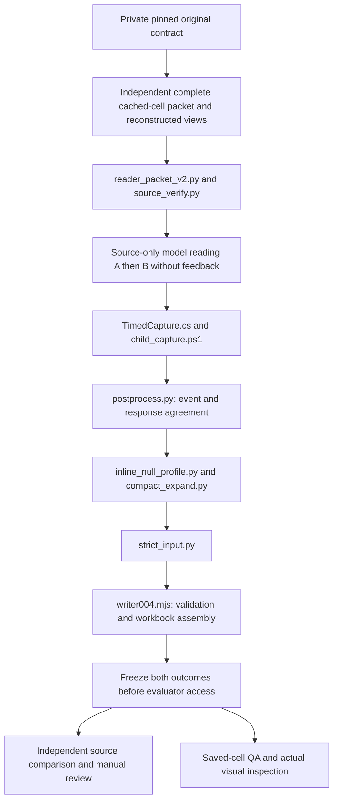

# CPS implementation map

This is a source-code handoff, not an installed or qualified release. Development was explicitly paused after checkpoint 045. Packaging these files does not resume development or admit a new model run. See [current status](../handoff/CURRENT_STATUS.md) and [resume plan](../handoff/RESUME_PLAN.md) first.

Two implementations are retained separately. They do not have interchangeable carriers, manifests, tests, or qualification claims.

## Installed deterministic baseline

[`src/installed_baseline`](../../src/installed_baseline) is the previously installed CPS parser, not the latest semantic research candidate. Its `runtime/cps.py` consumes an explicit contract allowlist and per-file hashes. It checks prohibited paths and workbook sheets, reads saved cells without recalculation, detects table/header/continuation structure, records physical-row dispositions and produces review-required 17-column candidates. It never reads historical target workbooks to generate values.

`runtime/verify_run.py` checks citation correspondence and optional repeat hashes. It is not a semantic evaluator. `runtime/export_workbooks.mjs` creates workbook artifacts using the separately supplied `@oai/artifact-tool` dependency. The exported `cps.ps1.txt` is a historical launcher reference; its former host paths are placeholders and its local qualification/pool artifacts are not public execution inputs.

`eligibility/screen_targets.py` is a separate evaluation-side target screen. A panel-dimension plus sign can exclude a misnamed target; a model/accessory plus sign does not. A successful command means a report was produced, not that a target became qualified gold. Its target observations must never feed generation. Preserve independent stage, adoption, version, and full-scope eligibility checks.

## Checkpoint 045 source-only research route

[`research/checkpoint045`](../../research/checkpoint045) contains the code actually used for the latest two original-contract readings, apart from private data and local bindings. Both readings reached workbooks and both failed source correctness. This route is an experimental semantic reader plus guarded assembly, not an upgrade silently installed over the deterministic baseline.

The model sees only the complete approved literal source packet, the ordered reconstructed inspection views, and generic instructions. It does not receive expected material values, failed-cell hints, historical answers, evaluation ledgers, customer drawings, or mailbox research. Generation and evaluator work remain separate roles.

| File or group | Responsibility | Important limit |
|---|---|---|
| `source_verify.py` | Exact Windows path/kind/hash checks; BIFF8 OLE structure and saved numeric formula-cache verification | Source identity and cache integrity are not semantic correctness or author adoption. XLSX branch retains signature-only verification. |
| `reader_packet_v2.py` | Joins every packet cell's coordinate, value, type and formula-presence flag to the original source; verifies full physical census and pinned PNGs | Reuses the extraction library; not native Excel equivalence or an independent parser claim. |
| `TimedCapture.cs`, `child_capture.ps1` | Bounded process capture, byte observations and own-child completion evidence | Does not establish provider/backend cancellation or OS-enforced no-tool isolation. |
| `postprocess.py` | Requires normal completion, approved event kinds, exactly one agent answer, matching event/envelope and monotonic byte observations | Unexpected tools/events hold the result after observation; the prompt restriction is not a stronger isolation guarantee. |
| `compact_expand.py`, `inline_null_profile.py` | Expands explicit model-authored references and fieldsets, rejects unused/unknown/duplicate/overlapping references, enforces inline null explanations | Structure only. No inference, omitted-field defaults, semantic repair, numeric repair or quantity multiplication. |
| `strict_input.py` | Strict JSON/type/size/source/location guard with original source verification | Does not grade whether the model allocated a fact to the right field. |
| `writer/writer004.mjs` | Carrier/source authorization, literal 17-column matrices, provenance review rows, saved workbook and expected-cell manifest | Preserves held/research status; output success does not pass content correctness. |
| `writer/receipt_bytes.mjs` | Bounded UTF-8 capture of the source-check subprocess receipt | Mechanical boundary only. |
| `writer/validate_carrier_v4.mjs`, `writer/validate_source_v4.mjs` | Run the actual writer's validation/authorization without export | Not substitutes for the saved workbook checks. |
| `postqa/qa_saved_external.py` | Reopens saved XLSX XML, checks all expected values/types and formula absence | Does not establish human-readable display or semantic accuracy. |
| `postqa/render_saved_ranges.mjs` | Reopens the saved workbook and renders complete main/component/link ranges plus labelled review samples | Rendering completion is not actual visual inspection. |
| `postqa/compare_repeat.py` | Checks exact carrier bytes and saved matrices for the separately marked assembly repeat | Same wrong input reproducing consistently is not correctness repeatability. |
| `research/evaluation/compare_source043.py` | Frozen case-specific source comparison, exact anchor correspondence, complete denominators and separate raw/nonitem/provenance diagnostics | Detail-only case comparator, not a general evaluator for new component cases. Mandatory semantic/manual checks stay separate. |

The main sheet is `未填研究草稿` with 17 columns A:Q. Components remain `組成參考`, linked separately in `組成連結`; they are not multiplied into extra purchases. `來源與審查` retains raw fields, evidence, null reasons and nonitems. Zero source components provides no component-performance or component-layout credit.

## Protocols and historical controls

The generic [`COMPACT_TRANSPORT.md`](../../research/checkpoint045/COMPACT_TRANSPORT.md), [`XLSX_READING_PROTOCOL.md`](../../research/checkpoint045/XLSX_READING_PROTOCOL.md), and [`PROMPT_CONTRACT.md`](../../research/checkpoint045/PROMPT_CONTRACT.md) are retained as source snapshots. Their internal older checkpoint labels are historical; the export manifest identifies the exact 045 copies. `RESPONSE_SCHEMA.json` describes the outer compact string envelope, not the full semantic contract; expansion and writer validation supply the deeper constraints.

In particular, `PROMPT_CONTRACT.md` says the separate042 C/D candidate is "unmeasured". That is preserved historical wording, not the current result: the generic C/D allocation protocol is included in `XLSX_READING_PROTOCOL.md`, was used in the045 route, and both045 readings failed the unchanged accuracy gate. Do not use the older sentence to erase those measured failures or infer a new untested candidate.

The exact used `PROMPT_v4.txt` is deliberately absent because it embeds private source cells. Do not recreate it from gold or model answers. The next method must clarify the existing numeric/blank/raw and nonitem conventions prospectively, preserve semantic decision responsibility, and follow the separately documented one-regression-pair cap.

The historical runner and native proposal checker are present as `.ps1.txt` references. They show the real stage ordering, exact admission checks and date/reserve consumer. Their 045 stop is expired. No supplied manifest, code hash, model choice, timing budget or approval automatically authorizes a new invocation. Restoring an extension or editing a deadline is not sufficient admission.

## Public completeness and private prerequisites

The public package includes the reusable implementation route and generic protocols. It is not a byte-complete replay archive. The following remain local: original sources and caches, source images, source/allowlist/dependency/admission manifests, complete material-bearing prompts, source expectations, private manual review, model responses, generated workbooks, original baseline qualification and frozen source/evaluation inventories. See [local setup](LOCAL_SETUP.md) and [source export manifest](SOURCE_EXPORT_MANIFEST.json).

No package installation, source reading, model call, CPS test, evaluator comparison, workbook export or refinement work was performed to create this export. Original CPS/run files remain unchanged.
